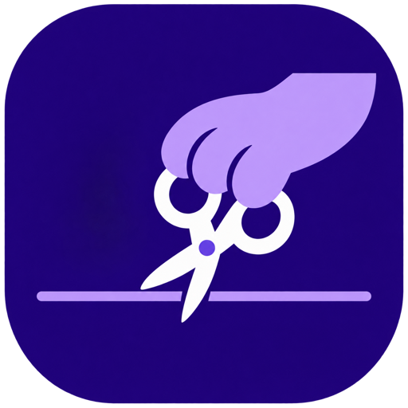

<p align="center">
  
</p>

<h1 align="center">SnipPaw</h1>

<p align="center">
  A macOS desktop app for finding, previewing, and precisely clipping moments from long videos and streams.
</p>

<p align="center">
  <a href="#features">Features</a> ·
  <a href="#requirements">Requirements</a> ·
  <a href="#development">Development</a> ·
  <a href="#build-a-release">Build a release</a>
</p>

## Features

- Create local projects from an MP4 file or a YouTube link.
- Download YouTube videos through `yt-dlp` as MP4 (H.264/AAC).
- Preview the source video with sound.
- Set clip boundaries from the timeline, subtitle rows, or AI-discovered moments.
- Zoom the timeline with controls or a trackpad pinch gesture.
- Preview the selected fragment once with `Space` to play or stop.
- Display an audio waveform below the timeline to spot quiet sections.
- Import SRT and VTT subtitles, then select a row to apply its exact interval.
- Use OpenAI to find moments such as jokes, conflicts, strong opinions, or custom criteria.
- Export clips as MP4 (H.264/AAC) with high, balanced, or compact quality settings.

AI analysis uses subtitle text only. Source video and audio are not sent to OpenAI. The API key is stored in the macOS Keychain.

## Requirements

- macOS
- Node.js and Rust — for local development
- [FFmpeg](https://ffmpeg.org/) — required for clip export and waveform generation
- `yt-dlp` and [Deno](https://deno.com/) — required only for importing a video from YouTube

On macOS, SnipPaw looks for Homebrew binaries in `/opt/homebrew/bin` and common system paths.

## Development

Install dependencies and start the desktop app:

```bash
npm install
npm run tauri dev
```

## Build a release

Build the macOS application bundle:

```bash
npm run tauri build -- --bundles app
```

The resulting application is located at:

```text
src-tauri/target/release/bundle/macos/SnipPaw.app
```

To create a distributable DMG:

```bash
cd src-tauri/target/release/bundle/macos

hdiutil create \
  -volname "SnipPaw" \
  -srcfolder SnipPaw.app \
  -ov \
  -format UDZO \
  SnipPaw-0.1.0-macos.dmg
```

Attach the resulting DMG to a GitHub Release. Until the app is signed with an Apple Developer ID and notarized, macOS may show a security warning when users open a downloaded build.

## Project files

Project metadata is stored in the app data directory. Source video may stay in its original location, while project workspaces and exported clips are stored in:

```text
~/Movies/SnipPaw/projects/<project-name>-<id>/
```

The waveform is cached with project data, so reopening a project does not regenerate it unless the source video has changed.

